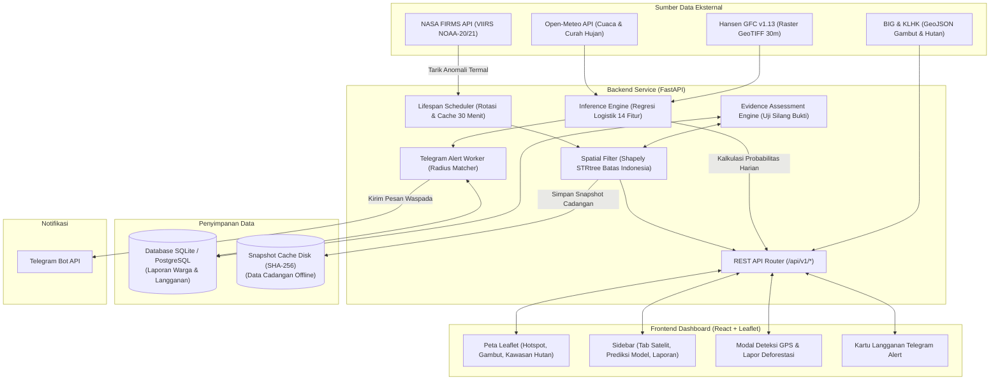

# JagaBorneo

> **JAGABORNEO: PLATFORM GEOSPASIAL UNTUK PEMANTAUAN KEBAKARAN HUTAN DAN LAHAN GAMBUT SERTA DEFORESTASI**  
> Dikembangkan oleh Tim **Info Kos Umar**

Platform geospasial terpadu berbasis web yang mengintegrasikan deteksi anomali termal satelit (NASA FIRMS), analisis tutupan dan kehilangan pohon (Hansen GFC v1.13), peta tematik kawasan hutan dan lahan gambut (KLHK & BIG), estimasi risiko karhutla berbasis Machine Learning (Open-Meteo & Regresi Logistik), sistem peringatan dini Telegram, serta mekanisme pelaporan masyarakat berbasis penilaian bukti geospasial (*cross-evidence assessment*).

---

## Daftar Isi

1. [Tentang Project](#tentang-project)
2. [Fitur Utama](#fitur-utama)
3. [Sumber Data dan Batasan Interpretasi](#sumber-data-dan-batasan-interpretasi)
4. [Teknologi yang Digunakan](#teknologi-yang-digunakan)
5. [Arsitektur Sistem](#arsitektur-sistem)
6. [Tampilan Aplikasi](#tampilan-aplikasi)
7. [Persyaratan Sistem](#persyaratan-sistem)
8. [Instalasi dan Menjalankan Project](#instalasi-dan-menjalankan-project)
9. [Konfigurasi Environment Variables](#konfigurasi-environment-variables)
10. [Struktur Direktori](#struktur-direktori)
11. [Panduan Penggunaan dan Batasan Sistem](#panduan-penggunaan-dan-batasan-sistem)
12. [Pengujian (Testing)](#pengujian-testing)
13. [Tim Pengembang](#tim-pengembang)
14. [Lisensi dan Referensi](#lisensi-dan-referensi)

---

## Tentang Project

Pulau Kalimantan merupakan salah satu bentang alam tropis terpenting di dunia dengan keanekaragaman hayati tinggi dan cadangan karbon masif yang tersimpan pada ekosistem hutan hujan tropis serta lahan gambut. Ancaman kebakaran hutan dan lahan (karhutla) serta perubahan tutupan hutan terjadi secara berulang, terutama saat musim kemarau dan fenomena iklim kering.

Tantangan utama dalam pemantauan lingkungan saat ini meliputi:
- **Fragmentasi Data:** Data anomali termal satelit, peta kawasan hutan, kesatuan hidrologis gambut, dan data cuaca mikro tersebar di berbagai instansi dan format yang berbeda.
- **Kesalahpahaman Interpretasi Data Satelit:** Titik panas (*hotspot*) satelit sering kali disalahartikan sebagai kepastian api yang membakar di permukaan tanah, padahal sensor inframerah hanya merekam anomali termal.
- **Ketiadaan Konteks Biofisik:** Titik hotspot yang tidak dipadukan dengan jenis ekosistem (misalnya kubah gambut dalam versus area non-gambut) menyulitkan penentuan prioritas penanganan.
- **Validasi Laporan Lapangan yang Lambat:** Laporan warga terkait indikasi deforestasi atau kebakaran sering kali tidak memiliki alat verifikasi awal untuk menguji kesesuaian spasial dan temporal terhadap data penginderaan jauh.

**JagaBorneo** hadir untuk menjembatani masalah tersebut sebagai instrumen pemantauan dan analisis awal. Platform ini tidak mengklaim dapat mencegah kebakaran secara instan atau membuktikan tindak pidana deforestasi secara otomatis di ranah hukum, melainkan menyajikan data geospasial yang telah divalidasi, terstruktur, dan kontekstual guna mendukung pengambilan keputusan awal, penelitian, dan partisipasi publik yang bertanggung jawab.

---

## Fitur Utama

Berikut adalah fitur yang telah diimplementasikan dan dapat dioperasikan pada repositori ini:

### 1. Peta Geospasial Interaktif & Pemantauan Hotspot Satelit
- **Visualisasi Hotspot NASA FIRMS:** Menampilkan titik anomali termal dari sensor VIIRS (satelit NOAA-20 dan NOAA-21) dengan resolusi 375 meter.
- **Filter Spasial Batas Daratan Indonesia:** Setiap koordinat divalidasi menggunakan struktur data *Point-in-Polygon* berbasis Shapely 2.x STRtree agar hanya titik daratan Indonesia yang diproses.
- **Fokus Wilayah Kalimantan:** Mendukung penyaringan khusus 5 provinsi di Kalimantan (Kalimantan Barat, Kalimantan Tengah, Kalimantan Selatan, Kalimantan Timur, dan Kalimantan Utara).
- **Segmentasi Kawasan Konservasi:** Opsi filter untuk memfokuskan tampilan hanya pada hotspot yang berada di dalam irisan Kawasan Hutan atau Lahan Gambut.
- **Filter Parameter:** Penyaringan berdasarkan rentang hari (1–3 hari terakhir), tingkat kepercayaan (*low*, *nominal*, *high*), dan ambang batas intensitas *Fire Radiative Power* (FRP).
- **Mode Sumber Data Ganda:** 
  - *Live API*: Menarik data terbaru langsung dari NASA FIRMS API.
  - *Data Cadangan*: Beralih otomatis atau manual ke arsip snapshot lokal berintegritas hash SHA-256 jika kuota API habis atau server offline.

### 2. Layer Tematik Ekosistem Lingkungan
- **Poligon Lahan Gambut (KHG):** Menampilkan batas Kesatuan Hidrologis Gambut (KHG) Kalimantan dari Badan Informasi Geospasial (BIG) dengan informasi landform dan bahan induk gambut.
- **Poligon Kawasan Hutan Resmi:** Menampilkan batas kawasan hutan Kalimantan (Hutan Lindung, Hutan Produksi, Konservasi) berdasarkan data Kementerian Lingkungan Hidup dan Kehutanan (KLHK / SatuPeta).
- **Overlay Segmentasi Hutan GLAD 2020:** Peta kuadran tutupan pohon berbasis dataset GLAD UMD dengan resolusi 30 meter.

### 3. Estimasi Kerentanan Karhutla Berbasis Machine Learning
- **Model Regresi Logistik Terlatih:** Memanfaatkan model inferensi terkalibrasi (`model_regresi_logistik.joblib`) dengan 14 parameter lingkungan:
  - *Cuaca mikro & presipitasi:* Curah hujan berjalan (`tp`), defisit akumulasi presipitasi 1 s.d. 5 bulan sebelumnya (`tp_1`–`tp_5`), suhu udara 2m (`t2m`), kelembaban relatif (`h2m`), dan kecepatan angin (`w10`) dari Open-Meteo API.
  - *Biofisik & vegetasi:* Riwayat kehilangan hutan primer/sekunder dan fraksi kanopi (`f_prim`, `loss_last_*`) dari Hansen GFC v1.13, kedalaman gambut (`peatd`), dan elevasi topografi DEM (`dem`).
- **Fitur "Prediksi Risiko" GPS Perangkat:** Tombol pada header yang mendeteksi koordinat pengguna via Geolocation API, menghitung estimasi probabilitas risiko kebakaran lokal, serta memaparkan dekomposisi kontribusi faktor cuaca versus vegetasi.
- **Hotspot Prediktif Harian (Siklus 24 Jam):** Tab khusus pada sidebar yang menyajikan titik-titik pemantauan Kalimantan dengan probabilitas risiko Sedang s.d. Tinggi, divisualisasikan dengan penanda belah ketupat (*diamond marker*) berwarna amber/oranye beranimasi denyut.

### 4. Sistem Peringatan Dini Telegram (Telegram Alerts)
- **Langganan Berbasis Radius Lokasi:** Pengguna dapat mendaftarkan koordinat dan radius pemantauan (5–200 km) melalui kartu antarmuka web.
- **Aktivasi Aman Melalui Token:** Web menghasilkan token tautan sekali pakai (`t.me/<bot>?start=<token>`) yang ditautkan ke akun Telegram pengguna tanpa mengekspos token bot ke publik.
- **Notifikasi Otomatis:** Sistem secara berkala memeriksa kemunculan hotspot prediktif tingkat Sedang atau Tinggi di dalam radius langganan dan mengirimkan ringkasan waspada ke chat Telegram.

### 5. Pelaporan Partisipasi Warga (Citizen Reporting) & Penilaian Bukti
- **Formulir Laporan Lapangan:** Warga dapat mengirim laporan untuk 5 kategori: `kebakaran`, `pembukaan_lahan`, `perambahan_hutan`, `penebangan_liar`, dan `perubahan_tutupan`, disertai koordinat, deskripsi, tanggal observasi, dan bukti foto.
- **Mesin Penilaian Bukti Geospasial (*Cross-Evidence Assessment*):**
  - Laporan kategori `kebakaran` dicocokkan secara otomatis dengan rekaman anomali termal NASA FIRMS terdekat (radius 10 km, rentang waktu $\pm 3$ hari).
  - Laporan kategori `pembukaan_lahan` dan `perubahan_tutupan` diuji terhadap riwayat piksel kehilangan tutupan pohon Hansen GFC 2000–2025.
- **Deteksi Indikasi Duplikasi:** Sistem menandai laporan yang berada dalam radius 5 km dan rentang waktu 24 jam dari laporan lain sebagai kandidat duplikasi.
- **Perlindungan Privasi Publik:** Koordinat yang ditampilkan ke publik dibulatkan ke 3 desimal (~110 meter) dan informasi kontak pelapor disembunyikan dari antarmuka umum.
- **Manajemen Verifikasi Petugas:** Autentikasi berbasis peran (*Warga* dan *Petugas*) yang memungkinkan petugas meninjau, memverifikasi (`VERIFIED`), atau menolak (`REJECTED`) laporan dengan catatan resmi.

### 6. Analisis Kehilangan Tutupan Pohon Ilmiah (Hansen GFC v1.13)
- Evaluasi statistik agregat per provinsi dan pembacaan piksel GeoTIFF Kalimantan periode 2000–2025 berdasarkan dataset University of Maryland (UMD).

---

## Sumber Data dan Batasan Interpretasi

Platform JagaBorneo memanfaatkan data dari sumber-sumber resmi berikut:

| Penyedia / Dataset | Jenis Data | Penggunaan dalam Platform | Tautan / Dokumentasi Resmi |
| :--- | :--- | :--- | :--- |
| **NASA FIRMS** | Anomali termal satelit (VIIRS NOAA-20 & NOAA-21, 375m) | Titik hotspot indikasi anomali suhu permukaan | [NASA FIRMS](https://firms.modaps.eosdis.nasa.gov/) |
| **Badan Informasi Geospasial (BIG)** | Poligon batas Kesatuan Hidrologis Gambut (KHG) | Konteks spasial lahan gambut dan karakteristik tanah | [Ina-Geoportal BIG](https://tanahair.indonesia.go.id/) |
| **Kementerian Lingkungan Hidup dan Kehutanan (KLHK)** | Poligon kawasan hutan resmi | Konteks batas legal dan fungsi hutan (Lindung/Produksi/Konservasi) | [SatuPeta KLHK](https://geoportal.menlhk.go.id/) |
| **Hansen GFC (UMD / GLAD v1.13)** | Raster GeoTIFF kehilangan tutupan pohon (30m, 2000–2025) | Analisis tren kehilangan tutupan pohon dan validasi laporan deforestasi | [Hansen UMD GFC](https://glad.earthengine.app/view/global-forest-change) |
| **Open-Meteo API** | Data meteorologi dan presipitasi historis | Parameter cuaca mikro untuk inferensi model regresi risiko karhutla | [Open-Meteo](https://open-meteo.com/) |

### Batasan Interpretasi Ilmiah

1. **Hotspot Bukan Kepastian Kebakaran Mutlak:**  
   Sensor VIIRS mendeteksi anomali suhu inframerah permukaan bumi. Ketiadaan hotspot tidak menjamin area tersebut bebas kebakaran (dapat terhalang awan tebal atau berupa kebakaran gambut bawah tanah /*smoldering fire*). Sebaliknya, keberadaan hotspot dapat dipicu oleh permukaan tanah terbuka yang panas atau aktivitas industri, sehingga konfirmasi lapangan (*ground check*) tetap diperlukan.
2. **Kehilangan Tutupan Pohon Bukan Bukti Otomatis Pelanggaran Hukum:**  
   Dataset Hansen GFC mencatat pelepasan kanopi pohon berketinggian $>5$ meter karena berbagai faktor, termasuk siklus pemanenan perkebunan legal, peremajaan tanaman keras, atau bencana alam. Penentuan deforestasi ilegal membutuhkan perbandingan izin konsesi dan regulasi tata ruang yang sah.
3. **Model Machine Learning adalah Alat Bantu Estimasi:**  
   Keluaran model regresi risiko karhutla merupakan probabilitas kerentanan lingkungan berdasarkan kombinasi indikator cuaca mikro dan tutupan vegetasi, bukan ramalan mutlak terjadinya kebakaran.

---

## Teknologi yang Digunakan

### Backend & Pemrosesan Data
- **Python:** 3.10+
- **Framework Web:** FastAPI (`>=0.115.0`) dengan server ASGI Uvicorn
- **Validasi Data:** Pydantic v2 & Pydantic-Settings
- **Geospasial:** Shapely 2.x (STRtree spatial indexing), Rasterio (analisis raster GeoTIFF), GeoAlchemy2
- **Machine Learning & Analisis Data:** Scikit-Learn (`1.6.1`), Joblib, Pandas, NumPy
- **Database & ORM:** SQLAlchemy 2.x (SQLite bawaan untuk lokal, kompatibel dengan PostgreSQL / Neon via `DATABASE_URL`)
- **Klien HTTP:** HTTPX (komunikasi asinkron ke NASA FIRMS, Open-Meteo, dan Telegram API)
- **Pengujian:** Pytest (230 pengujian otomatis)

### Frontend
- **Framework:** React 19 (TypeScript)
- **Build Tool:** Vite 8
- **Peta & Visualisasi Spasial:** Leaflet 1.9 dengan integrasi GeoJSON dan Custom Marker Layer
- **Styling:** Vanilla CSS dengan variabel kustom, dukungan tema gelap (*Dark Mode*) dan terang (*Light Mode*), serta tipografi modern
- **Linter & Formatter:** Oxlint

---

## Arsitektur Sistem

Alur kerja data dari sumber eksternal hingga visualisasi kepada pengguna dirangkum dalam diagram berikut:



---

## Tampilan Aplikasi

> [!NOTE]
> Screenshot antarmuka aplikasi dapat ditambahkan pada direktori `docs/screenshots/`. Bagian ini mendokumentasikan tata letak visual utama platform:

- **Dashboard Pemantauan Geospasial Utama:** Peta interaktif Leaflet yang memadukan titik api aktif, layer poligon gambut BIG, kawasan hutan KLHK, dan kontrol legenda.
- **Tab Prediksi Hotspot Harian:** Daftar lokasi pemantauan dengan estimasi probabilitas risiko Sedang s.d. Tinggi disertai penanda belah ketupat oranye beranimasi.
- **Modal Prediksi Risiko GPS:** Analisis kerentanan lokal berbasis posisi GPS perangkat pengguna dengan visualisasi kontribusi faktor iklim dan vegetasi.
- **Portal Pelaporan Warga & Verifikasi Bukti:** Formulir pengiriman indikasi kerusakan hutan serta rincian verifikasi bukti silang oleh petugas.

*(Untuk melengkapi tangkapan layar, simpan gambar pada direktori `docs/screenshots/` dengan nama seperti `dashboard-overview.png`, `predictive-hotspots.png`, dan `report-modal.png`).*

---

## Persyaratan Sistem

Pastikan perangkat Anda memenuhi spesifikasi berikut sebelum menjalankan project:

- **Sistem Operasi:** Windows 10/11, macOS, atau Linux
- **Python:** Versi `3.10` atau lebih tinggi
- **Node.js:** Versi `18.0.0` atau lebih tinggi (disarankan versi LTS)
- **Package Manager:** `npm` versi `9.0.0` ke atas (atau `pnpm` / `yarn`)
- **Git:** Versi terbaru

---

## Instalasi dan Menjalankan Project

### 1. Clone Repositori
```bash
git clone https://github.com/aditrajagula/karhutla.git
cd karhutla
```

### 2. Konfigurasi Backend (FastAPI)

1. Buat dan aktifkan virtual environment Python:
   - **Windows (PowerShell):**
     ```powershell
     python -m venv .venv
     .\.venv\Scripts\Activate.ps1
     ```
   - **Linux / macOS:**
     ```bash
     python3 -m venv .venv
     source .venv/bin/activate
     ```

2. Pasang dependensi backend:
   ```bash
   pip install -r backend/requirements.txt
   ```

3. Siapkan file environment variables:
   ```bash
   cp .env.example .env
   ```
   *(Pada Windows PowerShell, gunakan `Copy-Item .env.example .env`)*.

4. Buka file `.env` dan masukkan konfigurasi Anda (lihat bagian [Konfigurasi Environment Variables](#konfigurasi-environment-variables)).

5. Jalankan server FastAPI:
   ```bash
   uvicorn backend.app.main:app --reload --port 8000
   ```
   - Server Backend aktif di: `http://localhost:8000`
   - Dokumentasi Interaktif Swagger UI: `http://localhost:8000/docs`
   - Health Check: `http://localhost:8000/health`

### 3. Konfigurasi Frontend (React + Vite)

Buka terminal baru, lalu masuk ke direktori frontend:

1. Masuk ke folder frontend:
   ```bash
   cd frontend
   ```

2. Pasang dependensi Node.js:
   ```bash
   npm install
   ```

3. Buat file `.env` lokal untuk frontend jika diperlukan:
   ```bash
   cp .env.example .env
   ```

4. Jalankan development server:
   ```bash
   npm run dev
   ```
   - Antarmuka web aktif di: `http://localhost:5173`

---

## Konfigurasi Environment Variables

### 1. Backend (`.env` pada root project)

| Nama Variabel | Wajib / Opsional | Nilai Bawaan / Contoh | Deskripsi |
| :--- | :---: | :--- | :--- |
| `FIRMS_MAP_KEY` | Opsional | `ISI_API_KEY_ANDA` | MAP Key dari NASA FIRMS. Jika kosong, sistem otomatis memakai fallback snapshot lokal tim. |
| `FIRMS_DEFAULT_SOURCE` | Opsional | `VIIRS_NOAA20_NRT` | Sensor utama penginderaan anomali termal. |
| `FIRMS_BACKUP_SOURCE` | Opsional | `VIIRS_NOAA21_NRT` | Sensor cadangan jika sensor utama mengalami kendala. |
| `FIRMS_AREA_BBOX` | Opsional | `95.0,-11.0,141.5,6.0` | Batas koordinat Indonesia (*min_lon, min_lat, max_lon, max_lat*). |
| `FIRMS_REFRESH_INTERVAL_SECONDS` | Opsional | `1800` | Interval auto-refresh data satelit di latar belakang (dalam detik; 1800 = 30 menit). |
| `DATABASE_URL` | Opsional | *(Kosong)* | Connection string PostgreSQL (misal Neon / Render). Jika kosong, otomatis memakai SQLite lokal. |
| `REPORTS_DB_PATH` | Opsional | `data/citizen_reports.db` | Lokasi berkas SQLite laporan warga jika `DATABASE_URL` tidak disetel. |
| `SECRET_KEY` | Wajib (Prod) | `ganti-kunci-rahasia-ini` | Kunci rahasia untuk tanda tangan HMAC token autentikasi akun. |
| `CORS_ORIGINS` | Opsional | `*` | Daftar origin yang diizinkan untuk mengakses backend. |
| `TELEGRAM_BOT_TOKEN` | Opsional | `ISI_TOKEN_BOT_TELEGRAM` | Token bot dari @BotFather untuk fitur peringatan dini. |
| `TELEGRAM_BOT_USERNAME`| Opsional | `nama_bot_anda` | Username bot Telegram untuk tautan sambungan web. |
| `ALERTS_ENABLED` | Opsional | `true` | Mengaktifkan/menonaktifkan worker pengecekan alert Telegram. |
| `ALERTS_DRY_RUN` | Opsional | `false` | Jika `true`, alert hanya dicatat ke log tanpa dikirim ke Telegram nyata. |

### 2. Frontend (`frontend/.env`)

| Nama Variabel | Wajib / Opsional | Nilai Bawaan / Contoh | Deskripsi |
| :--- | :---: | :--- | :--- |
| `VITE_API_BASE_URL` | Opsional | `http://localhost:8000/api/v1` | Alamat base URL API backend. |
| `VITE_TELEGRAM_BOT_USERNAME` | Opsional | `nama_bot_anda` | Username bot Telegram yang dibuka saat pengguna menekan tombol aktivasi alert. |

---

## Struktur Direktori

Berikut adalah gambaran struktur berkas utama dalam repositori:

```text
karhutla/
├── backend/                           # Layanan Backend FastAPI
│   ├── app/                           # Sumber kode aplikasi utama
│   │   ├── main.py                    # Titik masuk FastAPI, router endpoint, & background tasks
│   │   ├── config.py                  # Pemuatan konfigurasi dan environment variables
│   │   ├── models.py                  # Definisi skema data Pydantic (Hotspot, Provenance)
│   │   ├── pipeline.py                # Orkestrator alur kerja pemrosesan data hotspot
│   │   ├── spatial_filter.py          # Pemfilteran spasial Point-in-Polygon (Shapely STRtree)
│   │   ├── cleaner.py                 # Pembersihan dan deduplikasi anomali termal
│   │   ├── snapshot_manager.py        # Pengelolaan data cadangan lokal dan integritas SHA-256
│   │   ├── firms_client.py            # Klien HTTP penarik data NASA FIRMS API
│   │   ├── weather_client.py          # Klien integrasi Open-Meteo & fallback klimatologi
│   │   ├── prediction_service.py      # Layanan inferensi model Regresi Logistik risiko karhutla
│   │   ├── alerts_service.py          # Layanan worker bot peringatan dini Telegram
│   │   ├── reports_storage.py         # Repositori basis data laporan warga & autentikasi
│   │   ├── evidence_service.py        # Mesin pengujian bukti silang laporan warga vs satelit
│   │   └── forest_change_service.py   # Layanan analisis kehilangan tutupan pohon Hansen GFC
│   ├── requirements.txt               # Daftar dependensi pustaka Python
│   └── tests/                         # Suite 230 unit dan integration test otomatis
├── frontend/                          # Aplikasi Web Antarmuka Pengguna (Vite + React + TS)
│   ├── src/
│   │   ├── App.tsx                    # Komponen induk dan state manajemen dashboard
│   │   ├── components/                # Komponen antarmuka modular
│   │   │   ├── map/MapContainer.tsx   # Peta Leaflet, layer poligon, dan penanda dinamis
│   │   │   ├── detection/             # Daftar hotspot satelit dan hotspot prediktif
│   │   │   ├── reports/               # Formulir laporan warga dan rincian verifikasi
│   │   │   ├── prediction/            # Modal deteksi risiko GPS dan kartu Telegram alert
│   │   │   └── status/StatusBar.tsx   # Header aplikasi, tombol aksi, dan pengalih tema
│   │   ├── services/api.ts            # Modul integrasi klien HTTP ke backend REST API
│   │   └── types/                     # Definisi tipe data TypeScript
│   ├── package.json                   # Konfigurasi dependensi Node.js
│   └── vite.config.ts                 # Konfigurasi bundler Vite
├── data/                              # Dataset geospasial dan model ML
│   ├── boundaries/                    # GeoJSON batas administratif 34 provinsi Indonesia
│   ├── context_layers/                # Layer GeoJSON tematik (gambut BIG & kawasan hutan KLHK)
│   ├── raster/hansen/                 # Berkas GeoTIFF tutupan kanopi pohon Hansen GFC v1.13
│   └── snapshots/                     # Berkas arsip snapshot hotspot lokal dan manifest
├── scripts/                           # Script bantu persiapan data dan benchmark
├── Procfile                           # Konfigurasi deployment container cloud (Render / Heroku)
├── requirements.txt                   # Pointer referensi dependensi ke backend/requirements.txt
├── .env.example                       # Contoh template konfigurasi environment backend
└── README.md                          # Dokumentasi resmi proyek
```

---

## Panduan Penggunaan dan Batasan Sistem

### Cara Menggunakan Aplikasi

1. **Memantau Titik Api Satelit (Tab Satelit):**
   - Buka tab "Satelit" pada panel kiri untuk melihat daftar anomali termal aktif.
   - Klik kartu hotspot pada daftar untuk mengarahkan peta ke koordinat terkait dan melihat parameter *FRP*, *confidence*, dan waktu observasi.
   - Gunakan filter di sisi kiri untuk menyaring data berdasarkan provinsi, rentang hari, tingkat kepercayaan, atau memfokuskan titik hanya pada kawasan hutan dan gambut.
2. **Memeriksa Hotspot Prediksi Harian (Tab Prediksi Model):**
   - Buka tab "Prediksi Model" untuk melihat titik-titik pemantauan dengan tingkat risiko Sedang s.d. Tinggi hasil estimasi model.
   - Titik pada peta ditandai dengan ikon belah ketupat jingga berdenyut.
3. **Mengecek Risiko Karhutla Sekitar Lokasi Anda:**
   - Klik tombol **Prediksi Risiko** pada header di bagian atas.
   - Berikan izin akses lokasi peramban (*browser*). Sistem akan menghitung estimasi probabilitas risiko kebakaran di titik koordinat Anda serta menampilkan faktor cuaca mikro dan tutupan kanopi lokal yang memengaruhinya.
4. **Mengirim Laporan Warga:**
   - Klik tombol **Lapor Deforestasi**.
   - Isi kategori laporan, pilih lokasi pada peta atau koordinat GPS, lengkapi deskripsi dan foto pendukung, lalu kirimkan. Laporan akan melalui tahap analisis bukti silang otomatis.
5. **Mengaktifkan Notifikasi Peringatan Dini Telegram:**
   - Buka kartu Telegram Alert di sidebar, atur radius pemantauan (misal: 25 km), dan klik tombol berlangganan untuk membuka bot Telegram. Tekan `/start` pada bot untuk mengaktifkan notifikasi.

### Batasan Sistem

- **Ketergantungan Cuaca pada Penginderaan Satelit:** Sensor optik dan inframerah satelit memiliki keterbatasan saat tertutup awan hujan lebat (*cloud cover*).
- **Cakupan Wilayah:** Fitur analisis lanjutan (segmentasi tutupan pohon GLAD, poligon kawasan hutan, dan model regresi karhutla) difokuskan dan dioptimalkan secara spesifik untuk Pulau Kalimantan.
- **Kebutuhan Verifikasi Lapangan:** Hasil analisis sistem berfungsi sebagai peringatan dini dan penapisan awal (*screening*). Tindakan hukum atau penanggulangan fisik tetap mewajibkan inspeksi langsung oleh pihak berwenang.

---

## Pengujian (Testing)

Proyek ini dilengkapi dengan **230 pengujian otomatis** pada direktori `backend/tests/` yang mencakup pengujian unit, integritas data geospasial, model regresi, mesin penilaian bukti, dan integrasi API.

Jalankan pengujian menggunakan virtual environment yang telah aktif:

```bash
# Menjalankan seluruh pengujian backend
pytest -v

# Menjalankan pengujian spesifik modul geospasial Kalimantan
pytest backend/tests/test_kalimantan_spatial.py -v

# Menjalankan pengujian mesin penilaian bukti laporan warga
pytest backend/tests/test_citizen_evidence_and_privacy.py -v

# Menjalankan pengujian model prediksi dan cuaca Open-Meteo
pytest backend/tests/test_predictive_model.py -v

# Menjalankan pengujian bot alert Telegram
pytest backend/tests/test_telegram_alerts.py -v
```

Untuk memverifikasi kompilasi frontend:
```bash
cd frontend
npm run build
```

---

## Tim Pengembang

Platform **JagaBorneo** dirancang dan dikembangkan oleh tim **Info Kos Umar**:

- **Yuma Hazza Yuditama**
- **Reynaldi Bertinus Hutagaol**
- **Raffie Aditya Akbar**
- **Syuraih Umar Khottob**

---

## Lisensi dan Referensi

### Lisensi
Lisensi resmi proyek saat ini berstatus **Perlu Ditentukan (To Be Determined)**. Seluruh hak cipta kode dan arsitektur dimiliki oleh tim pengembang Info Kos Umar untuk keperluan evaluasi dan pengembangan platform pemantauan lingkungan.

### Referensi dan Dokumentasi Resmi
- **NASA FIRMS (Fire Information for Resource Management System):** [https://firms.modaps.eosdis.nasa.gov/](https://firms.modaps.eosdis.nasa.gov/)
- **Hansen Global Forest Change Dataset (UMD / GLAD):** Hansen, M. C., et al. (2013). *High-Resolution Global Maps of 21st-Century Forest Cover Change*. Science, 342(6160), 850–853. [https://glad.earthengine.app/view/global-forest-change](https://glad.earthengine.app/view/global-forest-change)
- **Open-Meteo Weather API:** [https://open-meteo.com/](https://open-meteo.com/)
- **Badan Informasi Geospasial (BIG) Indonesia:** [https://tanahair.indonesia.go.id/](https://tanahair.indonesia.go.id/)
- **Kementerian Lingkungan Hidup dan Kehutanan (KLHK) SatuPeta:** [https://geoportal.menlhk.go.id/](https://geoportal.menlhk.go.id/)
- **FastAPI Documentation:** [https://fastapi.tiangolo.com/](https://fastapi.tiangolo.com/)
- **Leaflet.js Interactive Maps:** [https://leafletjs.com/](https://leafletjs.com/)
- **Shapely Geometrical Operations:** [https://shapely.readthedocs.io/](https://shapely.readthedocs.io/)
