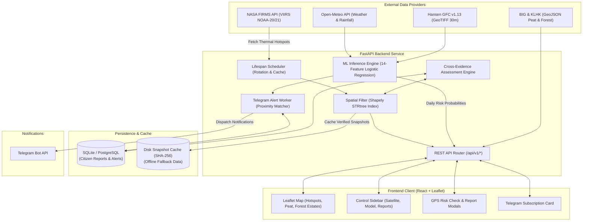

# JagaBorneo

> **JAGABORNEO: GEOSPATIAL PLATFORM FOR FOREST AND PEATLAND WILDFIRE MONITORING AND DEFORESTATION SURVEILLANCE**  
> Developed by **Info Kos Umar** Team

An integrated web-based geospatial platform combining satellite thermal anomaly detection (NASA FIRMS), tree cover and canopy loss analytics (Hansen Global Forest Change v1.13), official forest estate and peatland thematic layers (KLHK & BIG), machine-learning wildfire vulnerability estimation (Logistic Regression on Open-Meteo microclimate & biophysical variables), Telegram early warning alerts, and participatory citizen reporting backed by automated cross-evidence spatial verification.

---

## Table of Contents

1. [About the Project](#about-the-project)
2. [Key Features](#key-features)
3. [Data Sources & Scientific Interpretation Caveats](#data-sources--scientific-interpretation-caveats)
4. [Technology Stack](#technology-stack)
5. [System Architecture](#system-architecture)
6. [Application Overview](#application-overview)
7. [System Requirements](#system-requirements)
8. [Installation & Setup](#installation--setup)
9. [Environment Variables Configuration](#environment-variables-configuration)
10. [Directory Structure](#directory-structure)
11. [User Guide & Operational Scope](#user-guide--operational-scope)
12. [Testing](#testing)
13. [Development Team](#development-team)
14. [License & References](#license--references)

---

## About the Project

The island of Borneo (Kalimantan) is one of the planet's most critical tropical wildernesses, sustaining extraordinary biodiversity and globally significant terrestrial carbon reservoirs locked in its dense tropical rainforests and deep peatland domes. Recurring wildfires (*karhutla*) and rapid canopy loss threaten these ecosystems, particularly during dry seasons and climate-induced drought events.

Key challenges in environmental surveillance include:
- **Data Fragmentation:** Satellite thermal anomalies, administrative forest designations, peat hydrological units, and meteorological metrics reside in disparate agencies and non-standardized formats.
- **Misinterpretation of Satellite Remote Sensing:** Satellite thermal hotspots are frequently mistaken for verified open ground fires, overlooking the fact that infrared radiometers capture thermal radiance signatures, not visual fire confirmations.
- **Lack of Biophysical Context:** Hotspots analyzed without ecological context (e.g., deep peat domes vs. non-peat agricultural lands) hinder effective prioritization and resource dispatch.
- **Slow Validation of Field Incidents:** Citizen reports on deforestation or wild fires often lack pre-screening mechanisms to cross-examine spatial and temporal consistency against remote sensing archives.

**JagaBorneo** bridges these operational gaps as a screening, analytical, and public participation platform. Rather than asserting instant fire suppression or providing definitive legal proof of environmental crime, the system delivers structured, verified, and contextual geospatial intelligence to empower informed decision-making, academic research, and responsible civic stewardship.

---

## Key Features

The following core modules are fully operational in this repository:

### 1. Interactive Geospatial Map & Satellite Hotspot Monitoring
- **NASA FIRMS Hotspot Visualization:** Renders high-resolution thermal anomaly points from VIIRS sensors aboard NOAA-20 and NOAA-21 satellites (375-meter spatial resolution).
- **Indonesian Landmass Boundary Filtering:** Validates each coordinate via a high-performance *Point-in-Polygon* engine powered by Shapely 2.x STRtree indexing, ensuring only terrestrial points within Indonesia are processed.
- **Kalimantan Regional Focus:** Dedicated spatial boundaries locking view and analytics strictly to the 5 provinces of Indonesian Kalimantan (West, Central, South, East, and North Kalimantan).
- **Conservation & Ecosystem Segmentation:** One-click spatial filters isolating hotspots intersecting official Forest Estates or Peatland Hydrological Units (KHG).
- **Dynamic Parameter Filtering:** Filter observations by acquisition timeframe (last 1–3 days), confidence tier (*low*, *nominal*, *high*), and Fire Radiative Power (FRP in megawatts).
- **Dual Data Source Pipeline:**
  - *Live API Mode*: Streams real-time observations directly from the NASA FIRMS API.
  - *Snapshot Fallback Mode*: Automatically or manually switches to SHA-256 verified local snapshot archives when API quotas expire or external networks fail.

### 2. Environmental Thematic Layers
- **Peatland Hydrological Units (KHG):** Vector boundary overlays from the Geospatial Information Agency (BIG), including peat dome classification, landform type, and parent material data.
- **Official Forest Estates (Kawasan Hutan):** Boundary polygons from the Ministry of Environment and Forestry (KLHK / SatuPeta) covering Protection Forests (HL), Production Forests (HP/HPT), and Conservation Areas.
- **GLAD 2020 Forest Extent Overlay:** 30-meter resolution tree canopy extent overlays derived from the University of Maryland GLAD dataset.

### 3. Machine Learning Wildfire Risk Estimation
- **Trained & Calibrated Logistic Regression:** Leverages a machine learning model (`model_regresi_logistik.joblib`) incorporating 14 environmental and biophysical predictors:
  - *Microclimate & Precipitation:* Real-time precipitation (`tp`), cumulative precipitation deficit over 1 to 5 preceding months (`tp_1`–`tp_5`), 2-meter air temperature (`t2m`), relative humidity (`h2m`), and 10-meter wind speed (`w10`) sourced from Open-Meteo.
  - *Biophysical & Canopy Metrics:* Historical primary/secondary forest loss and canopy cover fraction (`f_prim`, `loss_last_*`) from Hansen GFC v1.13, peat depth (`peatd`), and digital elevation model (`dem`).
- **Device GPS "Risk Prediction":** Header action triggering device geolocation to evaluate local wildfire probability within a 25 km buffer radius, explaining climatic vs. vegetational contributing drivers.
- **24-Hour Daily Predictive Hotspots:** Dedicated sidebar feed identifying Kalimantan locations exhibiting Medium to High risk probabilities, visualized with pulsating diamond markers.

### 4. Telegram Early Warning Alert System
- **Radius-Based Location Subscriptions:** Users register coordinates and customized surveillance radii (5–200 km) directly from the interface.
- **Secure Token-Based Pairing:** Generates cryptographic, one-time authentication tokens (`t.me/<bot>?start=<token>`) connecting web requests to individual Telegram accounts without exposing bot credentials.
- **Automated Alert Dispatch:** A background worker scans for active hotspots and high-risk zones within subscribed perimeters, sending alerts directly to Telegram subscribers.

### 5. Participatory Citizen Reporting & Cross-Evidence Assessment
- **Field Reporting Form:** Empowers community members to submit field observations across 5 categories (`kebakaran`, `pembukaan_lahan`, `perambahan_hutan`, `penebangan_liar`, and `perubahan_tutupan`), complete with coordinates, descriptions, timestamps, and photographic evidence.
- **Cross-Evidence Spatial Assessment Engine:**
  - Wildfire reports are cross-referenced with NASA FIRMS satellite observations within a 10 km radius and $\pm 3$-day window.
  - Deforestation and logging reports are cross-examined against 30-meter Hansen GFC canopy loss pixels (2000–2025).
- **Duplicate Report Detection:** Identifies and flags potential duplicate reports filed within 5 km and 24 hours of existing entries.
- **Privacy Protection:** Public-facing coordinates are rounded to 3 decimal places (~110 meters), and personal contact details remain confidential.
- **Officer Verification Workflow:** Role-based authentication (*Citizen* vs. *Officer*) enabling forestry officers to review evidence, mark reports as `VERIFIED` or `REJECTED`, and attach official field notes.

### 6. Hansen Global Forest Change (v1.13) Scientific Analytics
- Aggregated provincial tree canopy loss metrics and localized 30-meter GeoTIFF pixel querying for Kalimantan covering 2000–2025, based on UMD / Google Earth Engine datasets.

---

## Data Sources & Scientific Interpretation Caveats

JagaBorneo integrates data from the following verified official providers:

| Provider / Dataset | Data Type | Role in Platform | Documentation / Source |
| :--- | :--- | :--- | :--- |
| **NASA FIRMS** | Satellite thermal anomalies (VIIRS NOAA-20 & NOAA-21, 375m) | Active thermal hotspot detection | [NASA FIRMS](https://firms.modaps.eosdis.nasa.gov/) |
| **Geospatial Information Agency (BIG)** | Vector polygons of Peatland Hydrological Units (KHG) | Peatland boundaries and depth classification | [Ina-Geoportal BIG](https://tanahair.indonesia.go.id/) |
| **Ministry of Environment and Forestry (KLHK)** | Vector polygons of official Forest Estates | Legal forest zoning (Protection, Production, Conservation) | [SatuPeta KLHK](https://geoportal.menlhk.go.id/) |
| **Hansen GFC (UMD / GLAD v1.13)** | GeoTIFF rasters of tree canopy loss (30m, 2000–2025) | Tree canopy loss history and deforestation verification | [Hansen UMD GFC](https://glad.earthengine.app/view/global-forest-change) |
| **Open-Meteo API** | Meteorological & historical precipitation parameters | Microclimate inputs for machine learning risk inference | [Open-Meteo](https://open-meteo.com/) |

### Scientific Interpretation Caveats

1. **Thermal Hotspots Are Not Definitive Wildfires:**  
   VIIRS sensors detect surface thermal infrared radiance anomalies. A lack of hotspots does not guarantee absence of fire (e.g., dense cloud cover, heavy smoke obstruction, or underground smoldering peat fires). Conversely, hotspots may occasionally register heated bare rock, metallic roofing, or industrial plants. Ground verification remains mandatory.
2. **Canopy Loss Does Not Automatically Prove Illegal Deforestation:**  
   The Hansen GFC dataset records removal of tree canopy exceeding 5 meters in height. This encompasses licensed plantation harvest cycles, agroforestry replanting, and natural tree mortality alongside deforestation. Legal determinations require review of official concession boundaries and land tenure permits.
3. **Machine Learning Risk Scores Are Probability Indicators:**  
   Risk percentages reflect relative ecological vulnerability based on climate and canopy moisture trends, serving as an early indicator rather than a deterministic forecast of fire occurrence.

---

## Technology Stack

### Backend & Data Processing
- **Language:** Python 3.10+
- **Web Framework:** FastAPI (`>=0.115.0`) with Uvicorn ASGI server
- **Data Validation & Settings:** Pydantic v2 & Pydantic-Settings
- **Geospatial Processing:** Shapely 2.x (STRtree spatial indexing), Rasterio (GeoTIFF raster operations), GeoAlchemy2
- **Machine Learning & Analytics:** Scikit-Learn (`1.6.1`), Joblib, Pandas, NumPy
- **Database & Persistence:** SQLAlchemy 2.x (Default SQLite; compatible with PostgreSQL / Neon via `DATABASE_URL`)
- **HTTP Client:** HTTPX (asynchronous requests to NASA FIRMS, Open-Meteo, and Telegram API)
- **Automated Testing:** Pytest

### Frontend
- **Framework:** React 19 (TypeScript)
- **Build Tool:** Vite 8
- **Map & Spatial UI:** Leaflet 1.9 with GeoJSON polygon layers and canvas-optimized custom markers
- **Styling:** Modular CSS architecture with CSS variables, dual theme support (*Dark Mode* and *Light Mode*), and custom responsive typography
- **Code Quality:** Oxlint

---

## System Architecture

The following diagram illustrates data flow from external providers to the web client:



---

## Application Overview

- **Interactive Geospatial Dashboard:** High-contrast Leaflet map displaying active satellite hotspots, official peat hydrological units (BIG), forest estates (KLHK), and thematic legends.
- **Daily Predictive Hotspot Feed:** Real-time list of monitoring points exhibiting Medium to High risk probabilities, highlighted on the map with animated amber diamond icons.
- **GPS-Based Wildfire Vulnerability Modal:** Instant evaluation of local fire susceptibility based on device GPS, with microclimate breakdown.
- **Citizen Report & Verification Portal:** Community submission modal with photo uploads, coupled with an officer review interface showing automated cross-evidence matching.

---

## System Requirements

Ensure your development environment meets the following specifications:

- **Operating System:** Windows 10/11, macOS, or Linux
- **Python:** Version `3.10` or higher
- **Node.js:** Version `18.0.0` or higher (LTS recommended)
- **Package Manager:** `npm` (v9.0.0+), `pnpm`, or `yarn`
- **Git:** Latest version

---

## Installation & Setup

### 1. Clone the Repository
```bash
git clone https://github.com/aditrajagula/karhutla.git
cd karhutla
```

### 2. Backend Setup (FastAPI)

1. Create and activate a Python virtual environment:
   - **Windows (PowerShell):**
     ```powershell
     python -m venv .venv
     .\.venv\Scripts\Activate.ps1
     ```
   - **Linux / macOS:**
     ```bash
     python3 -m venv .venv
     source .venv/bin/activate
     ```

2. Install backend dependencies:
   ```bash
   pip install -r backend/requirements.txt
   ```

3. Configure environment variables:
   - **Linux / macOS:**
     ```bash
     cp .env.example .env
     ```
   - **Windows (PowerShell):**
     ```powershell
     Copy-Item .env.example .env
     ```

4. Populate `.env` with your API keys (see [Environment Variables Configuration](#environment-variables-configuration)).

5. Launch the FastAPI server:
   ```bash
   uvicorn backend.app.main:app --reload --port 8000
   ```
   - Backend API: `http://localhost:8000`
   - Interactive OpenAPI Docs (Swagger UI): `http://localhost:8000/docs`
   - Health Check Endpoint: `http://localhost:8000/health`

### 3. Frontend Setup (React + Vite)

Open a separate terminal window and navigate to the `frontend` directory:

1. Enter frontend folder:
   ```bash
   cd frontend
   ```

2. Install dependencies:
   ```bash
   npm install
   ```

3. Create local frontend environment configuration if needed:
   ```bash
   cp .env.example .env
   ```

4. Start development server:
   ```bash
   npm run dev
   ```
   - Web application will be accessible at: `http://localhost:5173`

---

## Environment Variables Configuration

### 1. Backend (`.env` in repository root)

| Variable Name | Required | Default / Example Value | Description |
| :--- | :---: | :--- | :--- |
| `FIRMS_MAP_KEY` | Optional | `YOUR_API_KEY_HERE` | NASA FIRMS MAP Key. If omitted, system defaults to verified local snapshot archives. |
| `FIRMS_DEFAULT_SOURCE` | Optional | `VIIRS_NOAA20_NRT` | Primary satellite sensor for thermal anomalies. |
| `FIRMS_BACKUP_SOURCE` | Optional | `VIIRS_NOAA21_NRT` | Backup sensor if primary data stream is unavailable. |
| `FIRMS_AREA_BBOX` | Optional | `95.0,-11.0,141.5,6.0` | Bounding box coordinates for Indonesia (*min_lon, min_lat, max_lon, max_lat*). |
| `FIRMS_REFRESH_INTERVAL_SECONDS` | Optional | `1800` | Background satellite data refresh interval (in seconds; 1800 = 30 minutes). |
| `DATABASE_URL` | Optional | *(Empty)* | PostgreSQL connection string (e.g., Neon / Supabase). Defaults to local SQLite if omitted. |
| `REPORTS_DB_PATH` | Optional | `data/citizen_reports.db` | File path for SQLite database when `DATABASE_URL` is unset. |
| `SECRET_KEY` | Required (Prod) | `replace-with-secure-secret-key` | Secret key used for cryptographic HMAC token signing. |
| `CORS_ORIGINS` | Optional | `*` | Allowed CORS origins for backend access. |
| `TELEGRAM_BOT_TOKEN` | Optional | `YOUR_BOT_TOKEN` | Telegram bot token obtained from @BotFather for early warning alerts. |
| `TELEGRAM_BOT_USERNAME` | Optional | `your_bot_username` | Telegram bot username for pairing links. |
| `ALERTS_ENABLED` | Optional | `true` | Toggles the Telegram alert background checking worker. |
| `ALERTS_DRY_RUN` | Optional | `false` | When `true`, alerts are logged without dispatching actual Telegram messages. |

### 2. Frontend (`frontend/.env`)

| Variable Name | Required | Default / Example Value | Description |
| :--- | :---: | :--- | :--- |
| `VITE_API_BASE_URL` | Optional | `http://localhost:8000/api/v1` | Backend REST API base URL. |
| `VITE_TELEGRAM_BOT_USERNAME` | Optional | `your_bot_username` | Telegram bot handle opened when users trigger alert subscriptions. |

---

## Directory Structure

```text
karhutla/
├── backend/                           # FastAPI Backend Service
│   ├── app/                           # Core application code
│   │   ├── main.py                    # Entry point, API routers, and lifecycle events
│   │   ├── config.py                  # Pydantic configuration and environment variables
│   │   ├── models.py                  # Pydantic data schemas (Hotspot, Provenance, Risk)
│   │   ├── pipeline.py                # Hotspot processing and validation orchestrator
│   │   ├── spatial_filter.py          # Spatial Point-in-Polygon filter (Shapely STRtree)
│   │   ├── cleaner.py                 # Thermal anomaly deduplication and cleaning
│   │   ├── snapshot_manager.py        # Local snapshot management and SHA-256 integrity checks
│   │   ├── firms_client.py            # Asynchronous NASA FIRMS API client
│   │   ├── weather_client.py          # Open-Meteo meteorological client and climatology fallback
│   │   ├── prediction_service.py      # Logistic Regression wildfire vulnerability inference
│   │   ├── alerts_service.py          # Telegram alert dispatcher and subscription repository
│   │   ├── reports_storage.py         # Citizen reports database and authentication repository
│   │   ├── evidence_service.py        # Spatial cross-evidence engine (Reports vs. FIRMS & Hansen)
│   │   └── forest_change_service.py   # Hansen GFC tree canopy loss analysis service
│   ├── requirements.txt               # Backend Python library dependencies
│   └── tests/                         # Comprehensive unit and integration test suite
├── frontend/                          # Vite + React + TypeScript Web Application
│   ├── src/
│   │   ├── App.tsx                    # Main dashboard state container
│   │   ├── components/                # Modular UI components
│   │   │   ├── map/MapContainer.tsx   # Leaflet map, vector overlays, and canvas flame markers
│   │   │   ├── detection/             # Satellite hotspot and predictive hotspot lists
│   │   │   ├── reports/               # Citizen report submission modal and verification review
│   │   │   ├── prediction/            # GPS risk modal and Telegram alert card
│   │   │   └── status/StatusBar.tsx   # Application header, controls, and theme toggle
│   │   ├── services/api.ts            # Frontend HTTP client for backend REST API
│   │   ├── services/kalimantanLocation.ts # Regional geocoding and province/regency resolution
│   │   └── types/                     # TypeScript interface definitions
│   ├── package.json                   # Frontend dependencies and scripts
│   └── vite.config.ts                 # Vite build configuration
├── data/                              # Geospatial layers and ML artifacts
│   ├── boundaries/                    # Administrative boundary GeoJSON for Indonesia
│   ├── context_layers/                # Environmental thematic GeoJSON (BIG peat & KLHK forest)
│   ├── raster/hansen/                 # Hansen GFC v1.13 tree canopy GeoTIFF tiles
│   └── snapshots/                     # Local fallback snapshot archives and SHA-256 manifests
├── scripts/                           # Auxiliary data preparation and audit utilities
├── .env.example                       # Environment configuration template
├── .gitignore                         # Git exclusion rules
└── README.md                          # Official documentation
```

---

## User Guide & Operational Scope

### How to Use the Application

1. **Monitoring Satellite Hotspots (Satellite Tab):**
   - Select the "Satelit" tab on the left sidebar to view active thermal anomalies.
   - Click any hotspot card to center the map on the coordinates and inspect FRP, confidence tier, nearest regency (*kabupaten*), and distance/direction from the closest town.
   - Use the filter controls to adjust day ranges (1–3 days), confidence levels, or restrict points to peatlands and forest estates.
2. **Reviewing 24-Hour Predictive Risk Hotspots (Model Predictions Tab):**
   - Select the "Prediksi Model" tab to inspect monitoring locations exhibiting Medium to High risk probabilities calculated by the ML model.
   - Active predictive locations are indicated on the map with amber diamond markers.
3. **Assessing Local Wildfire Risk via GPS:**
   - Click the **Prediksi Risiko** button in the header.
   - Grant browser location permissions. The system calculates local wildfire risk probability within a 25 km buffer around your device and displays meteorological vs. vegetation drivers.
   - If outside Kalimantan, use the built-in simulation buttons (*Palangka Raya, Pontianak, Banjarmasin, Samarinda, Tanjung Selor*) to test features.
4. **Submitting a Citizen Report:**
   - Click **Lapor Deforestasi**.
   - Select the report category, pick coordinates on the map or use GPS, provide field descriptions and photos, and submit. The system automatically executes cross-evidence spatial verification.
5. **Enabling Telegram Alerts:**
   - Locate the Telegram Alert card in the sidebar or prediction modal, set your preferred monitoring radius (e.g., 25 km), and click subscribe to activate notifications via the Telegram bot.

### Operational Scope & Limitations

- **Cloud Cover Obstruction:** Satellite optical and infrared sensors are subject to cloud and smoke attenuation. Absence of a hotspot does not definitively rule out ground fire.
- **Geographic Specialization:** Advanced features (GLAD forest extent, KLHK forest estate boundaries, and machine learning models) are specifically calibrated and optimized for **Kalimantan**.
- **Field Verification Requirement:** System outputs serve as an early screening and decision-support mechanism. Official law enforcement actions require formal ground inspection by authorized personnel.

---

## Testing

The project includes an extensive automated test suite covering unit operations, spatial integrity, ML inference, cross-evidence engines, and API endpoints.

To run the backend tests:
```bash
# Run the complete backend test suite
pytest -v

# Run Kalimantan spatial boundary tests
pytest backend/tests/test_kalimantan_spatial.py -v

# Run citizen report cross-evidence assessment tests
pytest backend/tests/test_citizen_evidence_and_privacy.py -v

# Run machine learning model and weather client tests
pytest backend/tests/test_predictive_model.py -v

# Run Telegram notification worker tests
pytest backend/tests/test_telegram_alerts.py -v
```

To verify the frontend TypeScript and production build:
```bash
cd frontend
npm run build
```

---

## Development Team

The **JagaBorneo** platform was designed, engineered, and maintained by the **Info Kos Umar** team:

- **Yuma Hazza Yuditama**
- **Reynaldi Bertinus Hutagaol**
- **Raffie Aditya Akbar**
- **Syuraih Umar Khottob**

---

## License & References

### License
The official license for this project is currently **To Be Determined (TBD)**. All code and architectural rights are reserved by the development team (Info Kos Umar) for evaluation and environmental monitoring purposes.

### References & Official Data Providers
- **NASA FIRMS (Fire Information for Resource Management System):** [https://firms.modaps.eosdis.nasa.gov/](https://firms.modaps.eosdis.nasa.gov/)
- **Hansen Global Forest Change Dataset (UMD / GLAD):** Hansen, M. C., et al. (2013). *High-Resolution Global Maps of 21st-Century Forest Cover Change*. Science, 342(6160), 850–853. [https://glad.earthengine.app/view/global-forest-change](https://glad.earthengine.app/view/global-forest-change)
- **Open-Meteo Weather API:** [https://open-meteo.com/](https://open-meteo.com/)
- **Geospatial Information Agency (BIG) Indonesia:** [https://tanahair.indonesia.go.id/](https://tanahair.indonesia.go.id/)
- **Ministry of Environment and Forestry (KLHK) SatuPeta:** [https://geoportal.menlhk.go.id/](https://geoportal.menlhk.go.id/)
- **FastAPI Documentation:** [https://fastapi.tiangolo.com/](https://fastapi.tiangolo.com/)
- **Leaflet.js Interactive Maps:** [https://leafletjs.com/](https://leafletjs.com/)
- **Shapely Geometrical Operations:** [https://shapely.readthedocs.io/](https://shapely.readthedocs.io/)
